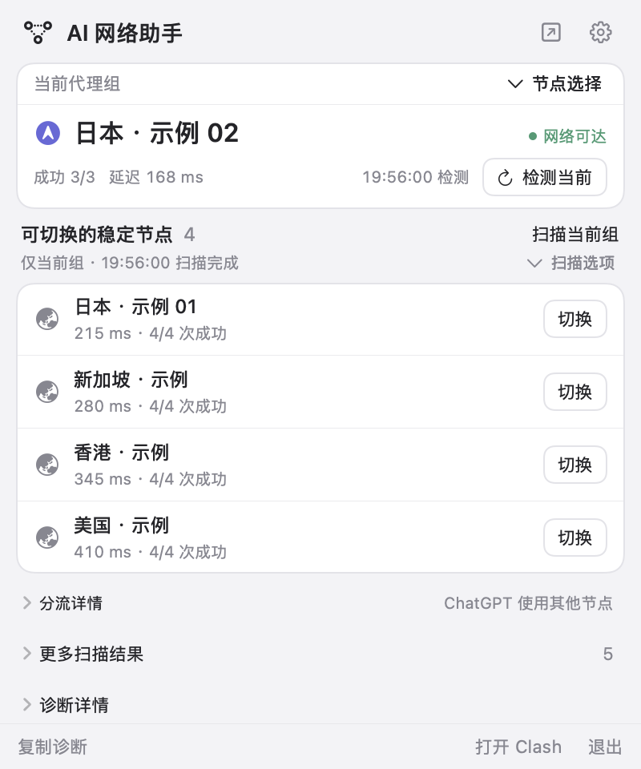
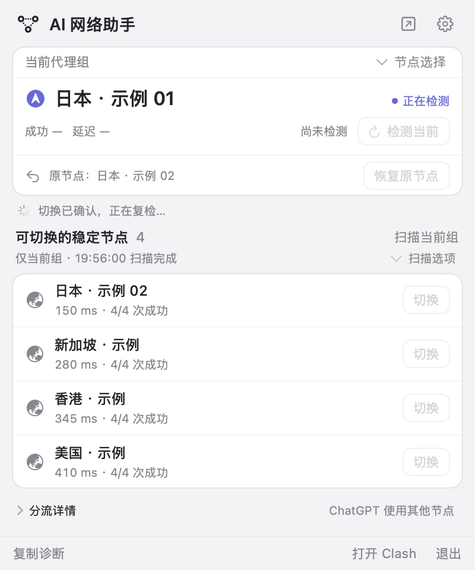
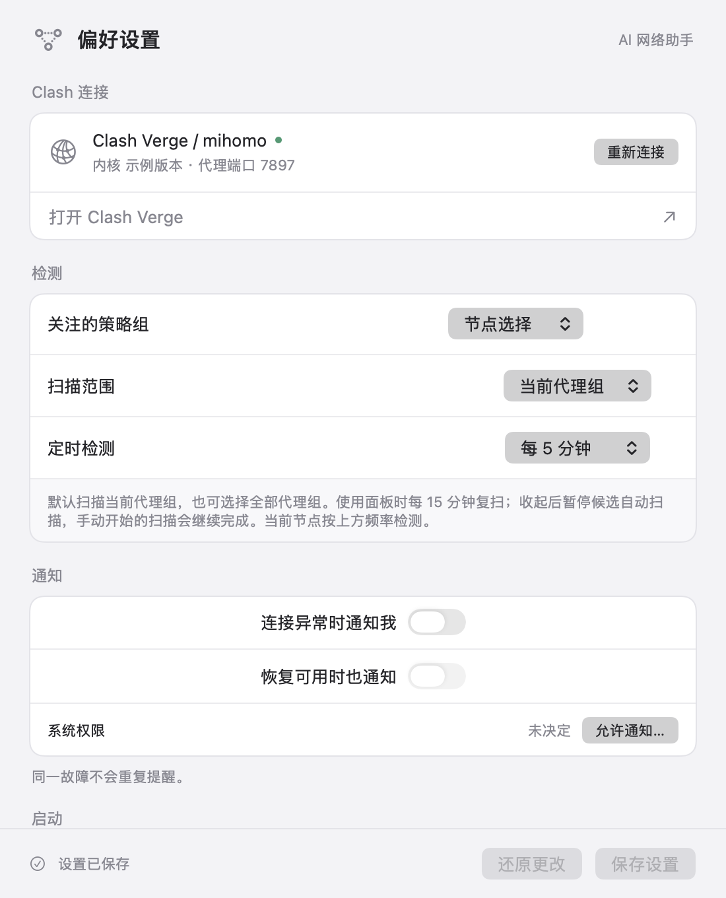
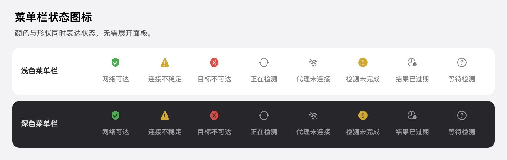

# AI 网络助手

一个原生 macOS 菜单栏工具，配合 Clash Verge / mihomo 使用。打开即可查看当前节点，下方直接列出当前代理组中可切换的稳定候选；点击「切换」后自动复检，必要时可以恢复原节点。

## 界面截图

以下截图由当前版本的真实 SwiftUI 界面离线渲染，**节点名称、延迟和检测结果均为示例数据**，不代表实时线路表现。

| 当前节点与稳定候选 | 切换后的自动复检 |
| --- | --- |
|  |  |

<details>
<summary>查看设置界面</summary>

<p></p>

设置页可向下滚动，继续查看开机启动及高级连接选项。

</details>

## 主要功能

- **当前节点常显**：展示代理组、实际节点、状态、成功率、延迟与最近检测时间。
- **筛选稳定候选**：默认扫描当前代理组，可选扫描全部代理组，相同节点去重。
- **行内直接切换**：候选行提供「切换」按钮，只操作当前组，随后自动复检。
- **恢复原节点**：入口紧邻当前状态，复检期间保留显示、暂时禁用操作。
- **同步 Clash 选择**：外部切换后更新实际节点，嵌套代理组也会解析到实际节点。
- **菜单栏状态提醒**：仅显示图标，用颜色和形状区分状态，悬停查看原因。
- **后台监控**：通知去重，支持恢复提醒、网络变化与 Mac 唤醒后复查。
- **本地诊断**：查看分流、出口观测与事件记录，复制脱敏诊断。

## 环境要求

| 项目 | 要求 |
| --- | --- |
| 系统 | macOS 14 或以上 |
| 处理器 | Apple Silicon，当前构建脚本面向 `arm64` |
| 代理客户端 | Clash Verge / mihomo，启用本地 Unix socket 控制接口 |
| 源码构建 | Xcode 或 Xcode Command Line Tools，提供 Swift 编译器 |
| 开发测试 | 部分测试需要 `/usr/bin/python3`，资源测量需要 `python3` |

运行使用系统框架和系统自带的 `curl`，不需要安装 Node.js、jq 或第三方运行库。当前版本已在本机 Apple Silicon Mac 上验证。

## 快速开始

保持 Clash Verge 正在运行，在项目根目录执行：

```bash
./scripts/run.sh
```

脚本会构建、签名并安装到 `~/Applications/AI网络助手.app`，随后启动。应用常驻屏幕顶部菜单栏，不显示 Dock 图标；点击菜单栏图标即可打开面板。

如果尚未安装 Swift 工具链，可以先执行：

```bash
xcode-select --install
```

其他构建方式：

```bash
./scripts/build.sh          # 只构建，产物位于 build/AI网络助手.app
./scripts/run.sh --no-open  # 构建并安装，暂不启动
```

再次运行安装脚本会更新已有应用。构建与签名成功后才替换旧版本，失败时保留原安装。

## 日常使用

1. **查看当前节点**：首页上方显示当前代理组和实际节点。默认关注主「节点选择」组，可在卡片菜单中更换。
2. **扫描候选**：点击「扫描当前组」。需要扩大范围时，在「扫描选项」选择「全部代理组」。
3. **选择稳定节点**：首页只显示当前组内可直接切换的稳定候选，排除正在使用的节点；未通过的节点可在「更多扫描结果」查看原因。
4. **点击切换**：点击候选行的「切换」即可操作，不需要展开详情或离开应用。切换后自动复检，并保留「恢复原节点」入口。
5. **查看详情**：展开「分流详情」「更多扫描结果」或「诊断详情」，查看服务分流、全部结果、出口观测和历史。

设置中可以调整检测间隔、扫描范围、通知与开机启动。系统通知需要授权；开机启动可能需要在 macOS「登录项」中批准。

### 扫描范围

默认扫描当前代理组的直接候选。嵌套代理组只解析其**当前实际节点**，不会因此展开整个订阅；相同节点只检测一次。

选择「全部代理组」时，会递归收集所有组中的实际节点并去重。扫描没有前 12 个节点的数量限制，最多同时检测 3 个节点。

即使扫描全部组，首页也只提供**当前组的直接成员**作为可切换候选。其他组节点可以查看检测结果，应用不会擅自修改策略组成员或分流规则。自动选择类型的策略组由 Clash 管理，手动切换请选择 Selector 组。

### 为什么主代理与 ChatGPT 节点可能不同？

Clash 规则模式允许不同服务使用不同代理组，例如：

| 策略组 | 示例选择 |
| --- | --- |
| 节点选择 | 日本节点 |
| ChatGPT | 新加坡节点 |

这两条线路可以同时生效。「当前代理组」表示你正在查看和操作的组；「分流详情」说明主代理与 ChatGPT 分流的区别。

## 菜单栏状态

菜单栏只显示图标，同时用颜色和图形传达状态。



| 状态 | 颜色与图标 | 含义 |
| --- | --- | --- |
| 正常 | 绿色勾选盾牌 | 本轮节点探测与当前代理访问均通过 |
| 不稳定 | 黄色警告三角 | 部分探测失败，或节点探测与当前访问结果不一致 |
| 目标不可达 | 红色八角叉号 | 节点复核与当前访问路径均未通过 |
| 检测中 | 灰色循环箭头 | 正在检测或切换后复检 |
| 未连接 | 灰色断开网络图标 | 无法连接代理控制接口 |
| 结果过期 | 灰色时钟图标 | 需要重新检测确认 |
| 未知 | 灰色问号 | 尚无有效检测结果 |
| 检测异常 | 黄色圆形感叹号 | 检测过程出错，不能据此断言节点故障 |

悬停图标可查看具体原因，点击后查看详情。

## 检测与稳定性判定

候选节点进行 **两轮检测，每轮两次**。四次全部成功，且延迟波动满足以下条件，才进入「本轮稳定」结果：

```text
最大延迟 − 最小延迟 ≤ max(1000 ms, 中位延迟 × 75%)
```

延迟低不是唯一标准；有失败或波动明显的节点不会被当作稳定候选。结果有效期为 15 分钟，未完成、取消、过期或相关配置发生变化时，不会用于授权切换。

**「本轮稳定」反映本轮样本，不保证长期稳定。** 探测目标为 `https://chatgpt.com/cdn-cgi/trace`，请求可达不代表登录、对话生成或 Codex 任务已经验证。当前访问出口来自现有分流路径，不保证等于所选节点的出口；候选节点的出口 IP 稳定性尚未验证。

## 后台调度与资源占用

| 场景 | 行为 |
| --- | --- |
| 面板打开 | 约每 2 秒同步 Clash 选择，打开时立即查询 |
| 面板收起 | 约每 15 秒同步选择，减少后台唤醒 |
| 当前节点监控 | 默认每 5 分钟检测，可在设置中调整 |
| 候选自动扫描 | 使用面板时首次及每 15 分钟扫描；收起后暂停重复自动扫描 |
| 手动开始的扫描 | 收起面板后仍会完成，也可手动取消 |
| 网络变化或 Mac 唤醒 | 清理过期状态并安排复查 |

本地控制请求使用进程内非阻塞 Unix socket，不为每次轮询或节点探测启动外部进程。外部 HTTPS 出口采样保留系统 `curl`，每次当前节点检测最多一次。

相同状态不重复发布到界面，排序、查找、图标和日期格式器复用缓存。扫描进度最多每 15 秒保存一次，完成、取消和设置更改立即保存。

观测本机资源占用：

```bash
python3 scripts/measure-resources.py \
  --duration 30 \
  --output build/perf/sample.json
```

报告包含 App 进程的 CPU、RSS、实际内存占用及子进程、状态文件写入观测。请比较相同使用场景；CPU 不包含 mihomo 开销，子进程及写入次数是采样下界。

## 本地数据与诊断

设置与状态保存在：

```text
~/Library/Application Support/VPNGPT/
├── settings.json
└── state.json
```

- 不需要 OpenAI 账号、Cookie 或 API Key。
- 事件记录最多保留 40 条。
- 出口观测保留近 24 小时，最多 2000 条。
- 目录创建权限为 `0700`，保存后的数据文件权限为 `0600`。
- 「复制诊断」会隐藏出口 IP 和本机控制接口路径。

数据保留在本机；正常探测会通过代理向目标服务发出网络请求。

## 开发与验证

项目使用 SwiftUI、AppKit 和原生异步 Unix socket，没有第三方运行库依赖。

```text
Sources/      应用、界面、检测与控制接口
Resources/    应用信息和图标生成代码
Tests/        控制接口、状态模型与交互流程回归
scripts/      构建、安装、预览、测试与资源测量
docs/images/  README 界面截图
```

运行全部测试：

```bash
for script in ./scripts/test*.sh; do
  "$script"
done
```

8 套测试脚本覆盖检测、切换与恢复、全组扫描、范围与外部选择同步、资源策略，以及原生 HTTP 传输的超时和取消。切换测试使用模拟控制接口，不切换真实节点；部分传输测试会启动临时本地服务。

重新生成文档截图：

```bash
./scripts/preview.sh docs/images
```

预览使用真实原生视图和临时示例数据目录，不读取你的代理配置，不发送探测请求，也不切换节点。

## 卸载

从菜单栏退出应用，删除 `~/Applications/AI网络助手.app`。如启用过开机启动，先在应用设置或系统「登录项」中关闭。

需要清除设置和历史时，再删除 `~/Library/Application Support/VPNGPT`。

## 许可证

本项目采用 [MIT License](LICENSE)。设计参考 [Universeeeeeee/VPN-Assitant](https://github.com/Universeeeeeee/VPN-Assitant)，当前为新的 Swift 实现，没有打包原始检测引擎。

参考项目及许可证说明见 [THIRD_PARTY_NOTICES.md](THIRD_PARTY_NOTICES.md)。
